<p align="center">
  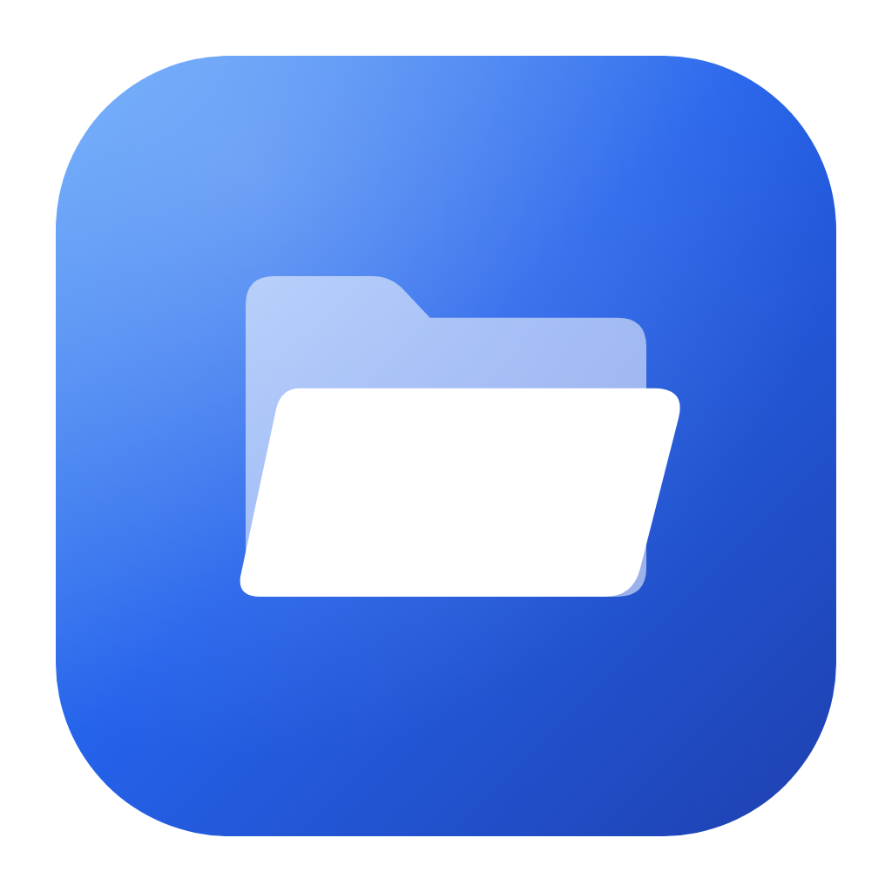
</p>

<h1 align="center">Explorer</h1>

<p align="center">
  <b>The universal file manager for Android, Windows and Linux.</b><br>
  Open, edit and share almost any file, without installing another app.
</p>

<p align="center">
  <a href="https://github.com/MSatyam-Mishra/explorer/releases"></a>
  
  
  
  
  <a href="LICENSE"></a>
</p>

<p align="center">
  <a href="https://github.com/MSatyam-Mishra/explorer/releases"><b>Download</b></a> ·
  <a href="#screenshots">Screenshots</a> ·
  <a href="#features">Features</a> ·
  <a href="#building-from-source">Build from source</a>
</p>

<p align="center">
  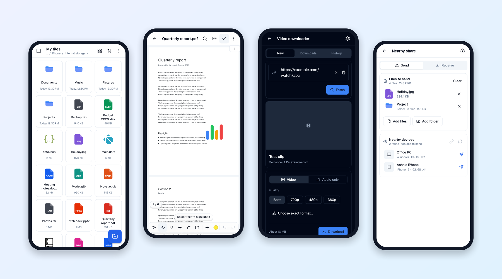
</p>

## Why Explorer?

<table>
  <tr>
    <td width="50%" valign="top">📂 <b>One app for every file</b><br>Over 300 file types open inside the app: documents, e-books, comics, archives, photos, video, music, 3D models and code.</td>
    <td width="50%" valign="top">✏️ <b>Edit, not just view</b><br>Annotate and sign PDFs, edit Word, Excel and PowerPoint files, and crop, adjust and filter photos.</td>
  </tr>
  <tr>
    <td valign="top">📡 <b>Share without cables</b><br>Send files to nearby phones and computers with LocalSend, or open a folder from any browser or FTP app over Wi-Fi.</td>
    <td valign="top">🎬 <b>Video downloader</b><br>Save videos or audio from over 1,000 sites, right from Android's <b>Share</b> menu.</td>
  </tr>
  <tr>
    <td valign="top">🔒 <b>Private vault</b><br>Keep files out of sight of other apps, behind your fingerprint, face or screen lock.</td>
    <td valign="top">🪶 <b>Small, free and open</b><br>A 28 MB download with no ads and no tracking. Free software under the GPL-3.0.</td>
  </tr>
</table>

## Screenshots

<table>
  <tr>
    <td align="center">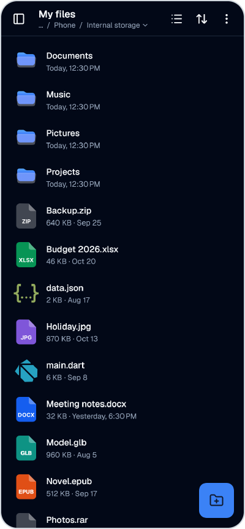<br><sub><b>Files</b>: list, grid or gallery</sub></td>
    <td align="center">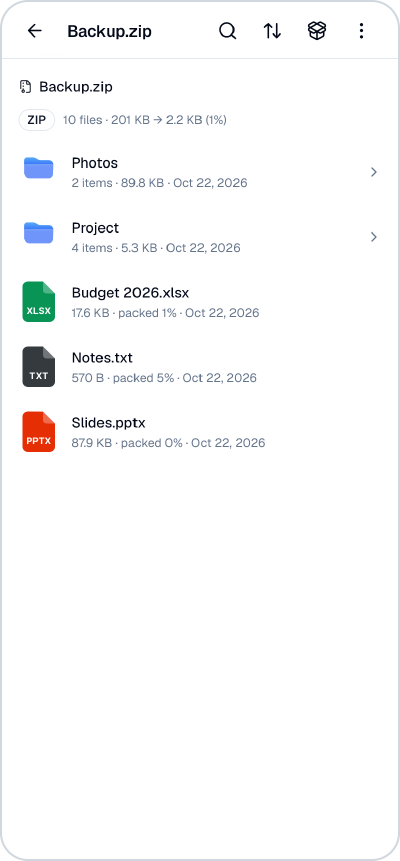<br><sub><b>Archives</b>: browse without extracting</sub></td>
    <td align="center">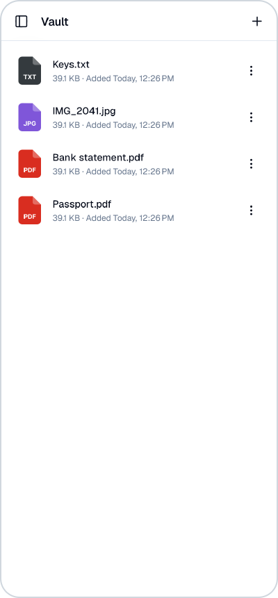<br><sub><b>Vault</b>: private files</sub></td>
    <td align="center">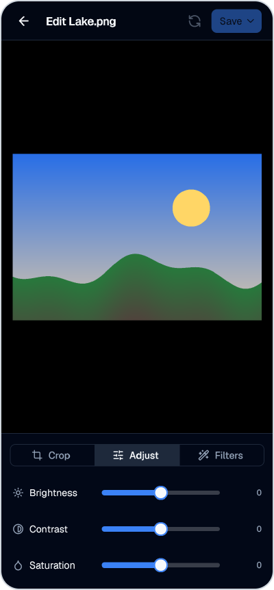<br><sub><b>Image editor</b></sub></td>
  </tr>
  <tr>
    <td align="center">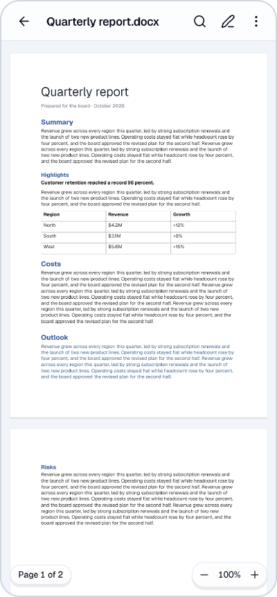<br><sub><b>Word</b> documents</sub></td>
    <td align="center">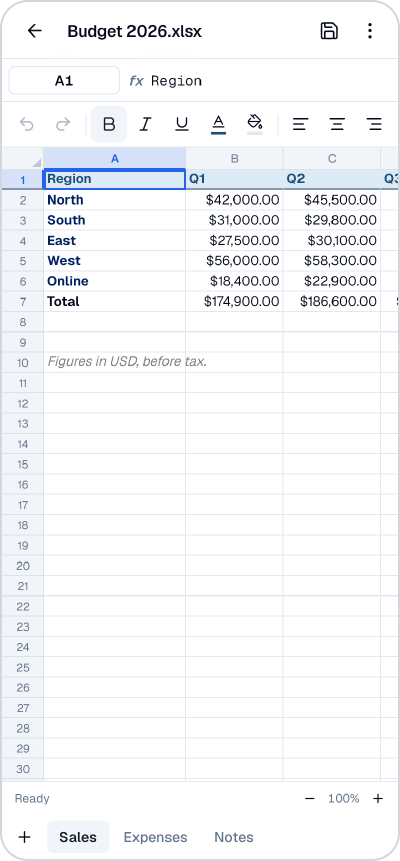<br><sub><b>Excel</b> spreadsheets</sub></td>
    <td align="center">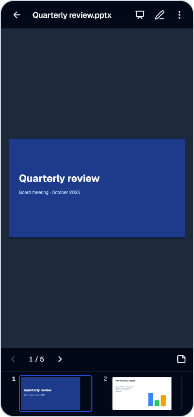<br><sub><b>PowerPoint</b> slides</sub></td>
    <td align="center">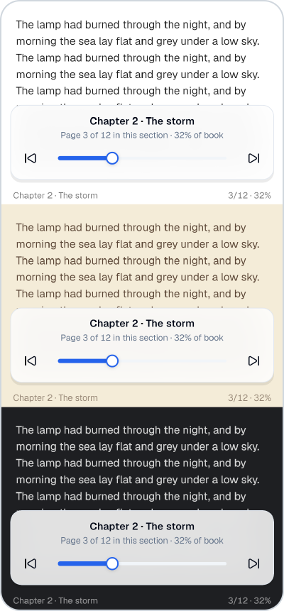<br><sub><b>E-books</b> in three themes</sub></td>
  </tr>
</table>

<p align="center">
  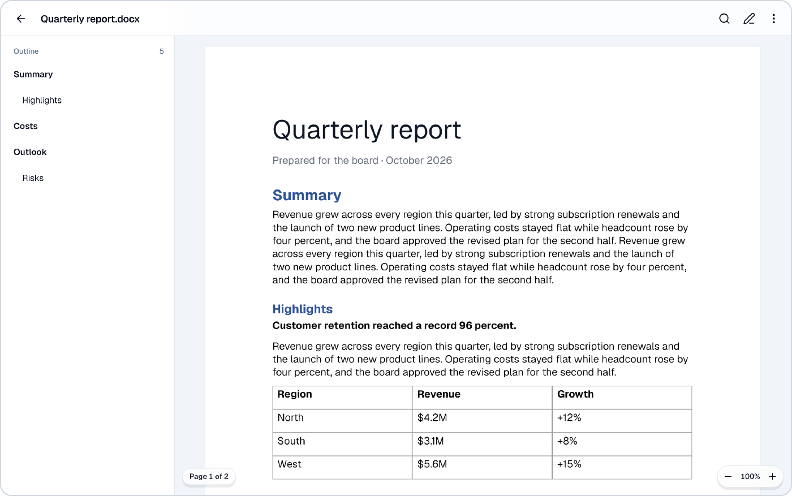<br>
  <sub>Tablets and foldables get two-pane layouts.</sub>
</p>

## Features

### 📁 A complete file manager

- Browse internal storage and SD cards in **list, grid, compact or gallery** view, sorted by name, size, date or type.
- **Copy, cut, paste, rename, delete and compress to ZIP**, with progress for long jobs. Select many files at once.
- **Properties and permissions** for any file, plus **Open with…** and **Share**.
- **Categories** gather photos, videos, music, documents, archives, downloads and installed apps in one place.
- Explorer shows up in Android's **Open with** and **Share** menus, so other apps can hand files to it.
- Light and dark themes, three file-icon styles, and layouts for phones, tablets and foldables.

### 🖥️ On Windows and Linux

- **Mouse like a desktop file manager**: click selects, double-click opens, Ctrl-click and Shift-click select several, and right-click opens a context menu.
- **Keyboard**: Enter opens, Delete deletes, F2 renames, Ctrl+A/C/X/V select all, copy, cut and paste, Ctrl+Shift+N makes a folder, F5 refreshes, Backspace or Alt+← goes up, Escape clears the selection.
- **Several windows**: Ctrl+N, or **Open in new window** on a folder.
- Video and audio play with [libmpv](https://mpv.io/) through media_kit. Images have previous and next buttons and arrow keys.
- Hidden and system files stay out of the way; **Options → Show hidden files** lists them.

### 📄 Opens almost anything

| Kind | Formats | What you can do |
|---|---|---|
| **PDF** | PDF | Read, search, highlight, underline, draw, add notes, sign, fill forms, rearrange pages, set or remove a password |
| **Word** | DOCX, DOC, RTF, ODT | Page view or reflowed text, outline, find, edit |
| **Spreadsheets** | XLSX, XLS, ODS, CSV, TSV | Formulas, formatting, several sheets, edit and save |
| **Presentations** | PPTX, PPT, ODP | Slideshow, speaker notes, edit text |
| **E-books and comics** | EPUB, FB2, MOBI, AZW3, CBZ, CBR, CB7, CBT | Reading themes, bookmarks, contents, search |
| **Archives** | ZIP, RAR (v4 and v5), 7z, TAR (gz, bz2, xz), ISO | Browse, open files inside, extract, passwords, multi-part archives |
| **Images** | JPG, PNG, WebP, GIF, HEIC, AVIF, TIFF, PSD, SVG and 24 camera RAW formats | View, see EXIF details, crop, adjust, apply filters |
| **Design and CAD** | AI, EPS, DWG, Sketch, Figma, Krita, Procreate, Affinity and more | Previews |
| **Video and audio** | MP4, MKV, WebM, AVI, MOV, MP3, FLAC, OGG, M4A and more | Built-in player |
| **3D models** | glTF/GLB, OBJ, STL, FBX, USDZ, Blender .blend and 20+ more | Turn, zoom, play animations, wireframe |
| **Code and text** | Source code, Markdown, JSON, HTML and other text files | Editor with syntax colours, find and replace, tabs |
| **Everything else** | Fonts, web pages, Lottie and Rive animations, any other file | Font preview, web view, animation player, hex viewer |

### 📡 Nearby share (LocalSend)

Explorer speaks the [LocalSend protocol](https://github.com/localsend/protocol), so it exchanges files with the official [LocalSend](https://github.com/localsend/localsend) app on Android, iOS, Windows, macOS and Linux, and with other copies of Explorer. No internet or account is needed; both devices only have to be on the same Wi-Fi or LAN.

- **Send**: select files or folders and tap **Send nearby**, then pick a device.
- **Receive**: open **Menu → Nearby share**. While it's open, other devices can find you, and you accept or decline each transfer. Received files go to `Download/LocalSend`.
- **Settings**: device name, PIN, auto-accept and folder.
- **Secure**: transfers use HTTPS with a certificate made on your device, as LocalSend does.

This is an independent implementation written from the protocol's specification. It isn't affiliated with the LocalSend project.

### 🌐 Wi-Fi sharing

Share a folder with any device on the same Wi-Fi: open **Menu → Wi-Fi sharing**, or **Options → Wi-Fi sharing** in any folder, and scan the QR code.

- **Browser (HTTP)**: a web page with search, list and grid views, photo and video previews, ZIP downloads of whole folders, and uploads.
- **FTP**: for File Explorer on Windows, Finder on a Mac, FileZilla and other FTP apps, with an optional password.
- Other devices can only change files (upload, rename, delete) if you allow it.

### 🎬 Video downloader

Download videos or audio from the [over 1,000 sites yt-dlp supports](https://github.com/yt-dlp/yt-dlp/blob/master/supportedsites.md), the same engine [VidBee](https://github.com/nexmoe/VidBee) uses on the desktop.

- In a browser or video app, tap **Share → Download video**, or open **Menu → Video downloader** and paste a link.
- Pick a quality up to 4K, audio only (M4A or MP3), or an exact format. Playlists work too.
- Downloads continue in the background with a notification and are saved to `Download/Explorer Videos`.
- yt-dlp keeps itself up to date.
- **On Android**, the first use asks to download the video engine (Python for yt-dlp, and FFmpeg): about 50 MB, or 120 MB once installed. It isn't in the APK, to keep the app small, and you can remove it in the downloader's settings.
- **On Windows and Linux**, the first use asks to download what's missing: the official yt-dlp, [FFmpeg](https://ffmpeg.org/) (yt-dlp's builds) and [Deno](https://deno.com/) (the JavaScript runtime YouTube needs), about 150 MB. An FFmpeg or JavaScript runtime already on your computer is used instead. Downloads resume if the connection drops, are checked against their published checksums, and can be removed in the downloader's settings. On a Mac, install FFmpeg with Homebrew.

Only download content you have the right to download, and respect each site's terms.

### 🔒 Vault and tools

- **Vault** (Android, Windows, macOS): move private files out of sight with **Move to vault** in a file's menu. It opens with your fingerprint, face, Windows Hello or screen lock.
- **App manager**: search installed apps, including system apps, and open their details.
- **USB boot** (Android): write an `.iso` or `.img` disk image to a USB drive to make it bootable (needs a rooted phone).

## Download

Get the latest version from **[Releases](https://github.com/MSatyam-Mishra/explorer/releases)**. Each release lists SHA-256 checksums in `SHA256SUMS.txt`.

### Android

Android 7.0 or newer. New versions install over older ones as an update.

| File | For |
|---|---|
| `…-arm64-v8a.apk` | **Most phones and tablets** (64-bit) |
| `…-armeabi-v7a.apk` | Older 32-bit phones |
| `…-x86_64.apk` | Emulators and x86 Chromebooks |
| `…-universal.apk` | Not sure which? Works on every device, but is larger |

### Windows

Windows 10 or 11, 64-bit.

| File | How to install |
|---|---|
| `…-windows-x64-setup.exe` | **Recommended.** Run it. It installs for your user, without asking for admin rights. |
| `…-windows-x64.msix` or `…-windows.msixbundle` | Windows app package. Trust its certificate first (below), then open the file. |

- Windows may say it protected your PC, because the app isn't code-signed. Choose **More info → Run anyway**.
- To install the MSIX packages, trust their certificate once: open `…-windows-msix-certificate.cer`, choose **Install Certificate → Local Machine → Place all certificates in the following store → Trusted People**.

### Linux

64-bit, on a recent distro: Ubuntu 24.04, Debian 13, Fedora 40, openSUSE Tumbleweed or newer. The `.deb`, `.rpm` and snap use the system's libmpv for video; the others bring their own.

| File | How to install |
|---|---|
| `…-linux-amd64.deb` | Debian, Ubuntu, Linux Mint: `sudo apt install ./explorer-…-linux-amd64.deb` |
| `…-linux-x86_64.rpm` | Fedora: `sudo dnf install ./explorer-…-linux-x86_64.rpm`; openSUSE: `sudo zypper install ./explorer-…-linux-x86_64.rpm` |
| `…-linux-x86_64.AppImage` | Any distro: make it executable (`chmod +x`) and run it. Some distros need `libfuse2` first. |
| `…-linux-x86_64.flatpak` | `flatpak install ./explorer-…-linux-x86_64.flatpak` (its runtime comes from Flathub) |
| `…-linux-amd64.snap` | `sudo snap install --dangerous ./explorer-…-linux-amd64.snap` |
| `…-linux-x64.tar.gz` or `.tar.xz` | Any distro: extract it and run `explorer/explorer` |

## Building from source

Requires Flutter 3.44 or newer. Releases include Android, Windows and Linux builds; macOS can be built from source.

```sh
flutter pub get
flutter run
```

Release APKs (all ABIs plus universal, obfuscated, with SHA-256 checksums) are built into `build/release/v<version>/`. The video downloader adds about 4 MB per APK (its engine is downloaded on first use); add `--without-video-downloader` for a build without it:

```sh
python tool/build_release.py
python tool/build_release.py --without-video-downloader
```

The Windows and Linux apps are built and packaged by GitHub Actions ([desktop-release.yml](.github/workflows/desktop-release.yml)) when a release is published, and attached to it; the packaging files are in [packaging/](packaging/). To build them yourself, run `flutter build windows` or `flutter build linux`. Windows builds need `nuget.exe` on the `PATH`, for the web view plugin.

Release signing reads `android/key.properties`, which is git-ignored. Without that file, builds use the debug key.

```properties
storePassword=…
keyPassword=…
keyAlias=…
storeFile=C:/path/to/release.jks
```

After adding or renaming icons in `assets/iocns`, regenerate the icon catalog:

```sh
python tool/generate_file_icon_catalog.py
```

The screenshots in this README come from the screenshot tests: `SCREENSHOTS=1 flutter test test/screenshots` writes them to `build/screenshots/`.

## Credits and third-party software

| Project | Used for | License |
|---|---|---|
| [LocalSend](https://github.com/localsend/localsend) / [protocol](https://github.com/localsend/protocol) | Nearby sharing protocol; implemented from the spec | Apache-2.0 |
| [VidBee](https://github.com/nexmoe/VidBee) | Reference for the video downloader's features | MIT |
| [yt-dlp](https://github.com/yt-dlp/yt-dlp) | Video download engine | Unlicense |
| [youtubedl-android](https://github.com/yausername/youtubedl-android) | yt-dlp, Python and FFmpeg on Android | GPL-3.0 |
| [FFmpeg](https://ffmpeg.org/) (Android build, downloaded on first use) | Merging and converting downloads | GPL-3.0-or-later |
| [Python](https://www.python.org/) (Android build, downloaded on first use) | Runs yt-dlp | PSF-2.0 |
| [koni_archive](https://github.com/zenbaku/koni_archive) | RAR and 7z decoding (patched copy in `third_party/koni_rar`) | MIT |
| [three.js](https://threejs.org/) | 3D model viewer | MIT |
| [pdfrx](https://github.com/espresso3389/pdfrx) | PDF viewer | MIT |
| [PDFium](https://pdfium.googlesource.com/pdfium/) | PDF rendering, editing, forms and annotations | BSD-3-Clause |

The full list, with every Dart package's license, is under **Menu → About and licences** in the app.

## License

Explorer is free software: you can redistribute it and/or modify it under the terms of the [GNU General Public License](LICENSE), version 3 or (at your option) any later version. It is distributed in the hope that it will be useful, but without any warranty; see the license for details.

Third-party components keep their own licenses (listed above, and under **Menu → About and licences** in the app).
